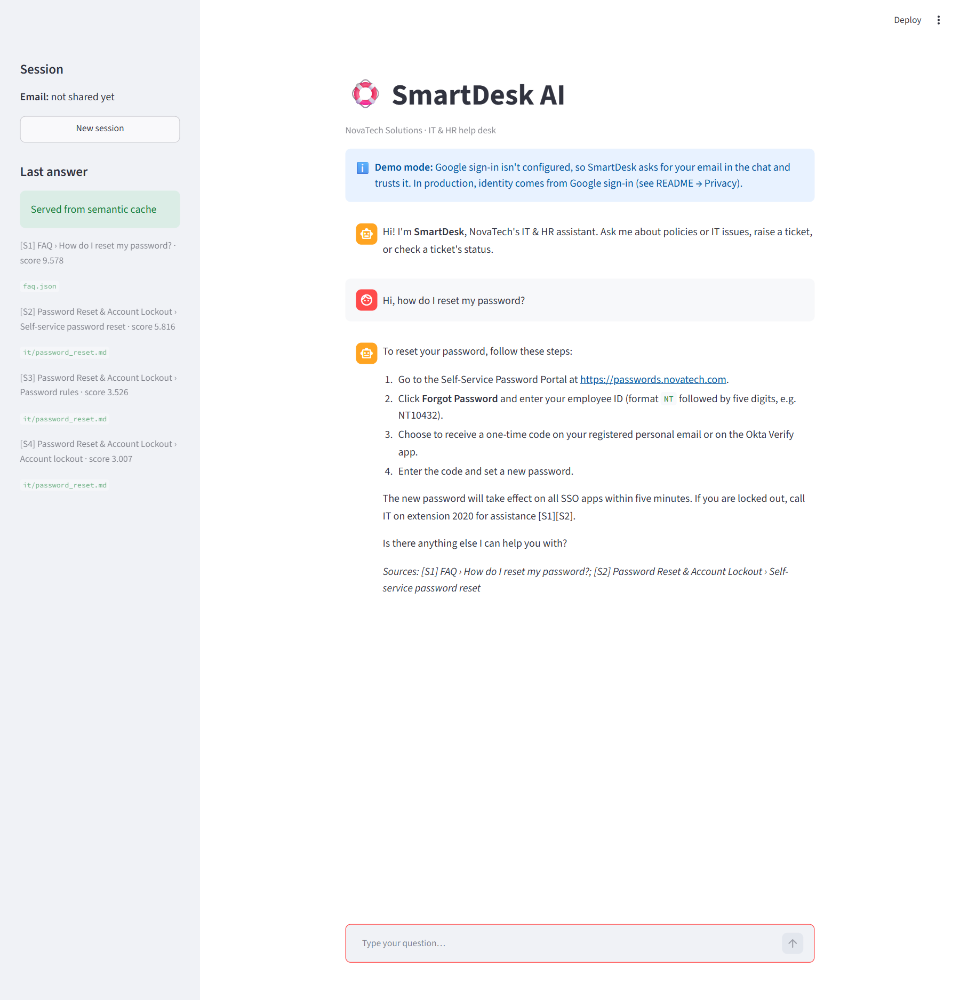
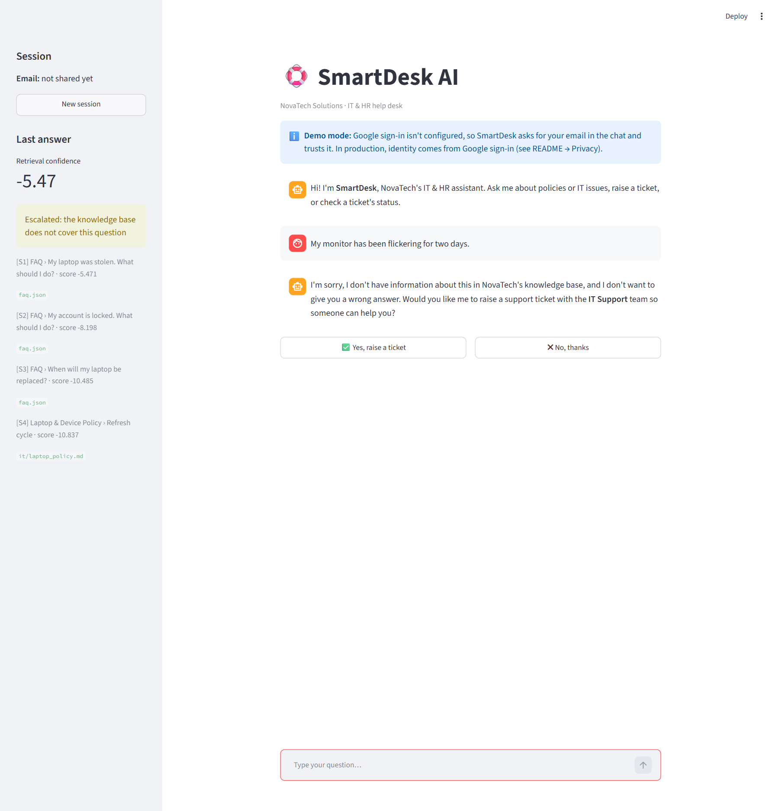
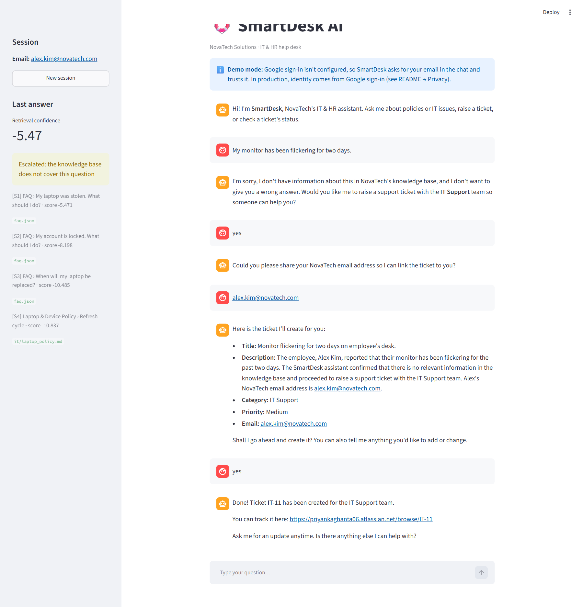
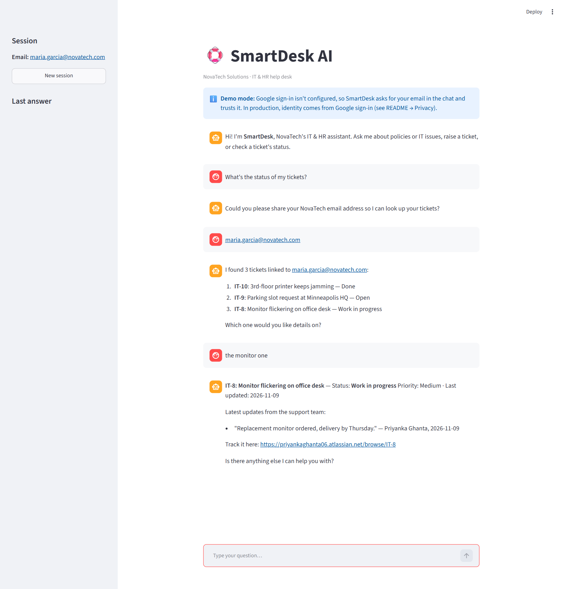

# SmartDesk AI — Intelligent IT & HR Operations Agent

SmartDesk is a first-line IT and HR help desk agent for **NovaTech Solutions**, a fictional 500-person SaaS company headquartered in Minneapolis, Minnesota, USA. It does three things:

1. **Answers questions from a knowledge base** using hybrid RAG (dense + BM25 → RRF → cross-encoder re-ranker), with an answer grounded in, and citing, the retrieved policy sections.
2. **Escalates questions it can't answer** to a **Jira Cloud** ticket. It collects the email, summary, description, category and priority, shows a preview, and creates the ticket **only after explicit confirmation**. It then returns the ticket key and link.
3. **Checks ticket status.** It looks up the employee's tickets in Jira by email, lists them when there are several, shows the status and the support team's comments, and says clearly when there are none.

Bonus features implemented: hybrid search with a re-ranker, IT/HR specialist sub-agents, a semantic cache, a Streamlit UI, and a LangSmith evaluation pipeline with LLM judges.

> Architecture diagrams (components, agent graph, escalation sequence and evaluation) are in [docs/architecture.md](docs/architecture.md).

### Demo video (1 min 30 s)
**[▶ Watch the demo::C:\Users\priya\smartdesk-ai\docs\demo\smartdesk-demo.mp4 (sped up about 2×; a [real-time version](docs/demo/smartdesk-demo-full.mp4) is 3 min 20 s) shows six flows in one session, against the live Jira project
1. Answer from the KB with cited sources, plus a follow-up that keeps the context
2. Gap in the KB → ticket offer to the right team → preview, edited to high priority → created only after "Yes"
3. Ticket status: email remembered, 6 tickets listed, "the monitor one" picked → status and support comments
4. Ticket offer declined → nothing created
5. Off-topic request politely declined
6. New session, employee with no tickets → "no tickets found"

### Quick start (about 5 minutes, no Jira account needed)
```bash
python -m venv .venv && .venv\Scriptsctivate          # macOS/Linux: source .venv/bin/activate
pip install -r requirements.txt
cp .env.example .env     # set OPENAI_API_KEY, and TICKETING_BACKEND=mock to skip Jira
python scripts/build_index.py
streamlit run app/streamlit_app.py                        # http://localhost:8502
pytest -q                                                 # 66 tests
```
Full setup with a live Jira project is in [Setup](#setup).

### Where to look
| If you want to check… | Open |
|---|---|
| The whole agent graph in one file | [smartdesk/agent/flow.py](smartdesk/agent/flow.py) |
| How an answer is grounded and when it escalates | [smartdesk/rag/answer.py](smartdesk/rag/answer.py), [smartdesk/rag/confidence.py](smartdesk/rag/confidence.py) |
| Jira create / search / comments | [smartdesk/ticketing/jira.py](smartdesk/ticketing/jira.py) |
| The knowledge base and its deliberate gaps | [kb/](kb/), [kb/GAPS.md](kb/GAPS.md) |
| Evaluation numbers | [eval/results.md](eval/results.md), [eval/results_router.md](eval/results_router.md), [eval/results_agent.md](eval/results_agent.md) |
| Screenshots of the three flows | [docs/screenshots/](docs/screenshots/) |

---

## Rubric coverage

| Criterion | How SmartDesk meets it | Evidence |
|---|---|---|
| **RAG grounding** | Every answer is generated only from retrieved KB sections and cites them inline (`[S1]`) with a sources footer. If the context doesn't contain the answer, the model must reply `INSUFFICIENT_CONTEXT` instead of guessing. | Groundedness **1.00** (LLM judge) in every retriever mode; 0 of 12 unanswerable questions answered ([eval/results.md](eval/results.md)); [answer.py](smartdesk/rag/answer.py), [prompts.py](smartdesk/rag/prompts.py) |
| **Escalation logic** | Three layers: no chunks retrieved → re-ranker score below a calibrated threshold (−5.5) → the LLM's `INSUFFICIENT_CONTEXT`. Any of them offers a ticket for the right team (IT or HR). | Escalation recall **1.00**, F1 **0.96** on 48 golden questions; threshold chosen by the eval's sweep; [confidence.py](smartdesk/rag/confidence.py), [ticket.py](smartdesk/agent/ticket.py), [threshold sweep](eval/run.py#L184) |
| **Ticket creation** | Collects email, title, description, category and priority; asks for details if the conversation lacks them; shows a full preview; creates the Jira ticket **only after "yes"** (edits and "no" are handled); returns the key and link. Retries can't create duplicates. | [agent/ticket.py](smartdesk/agent/ticket.py), [ticketing/jira.py](smartdesk/ticketing/jira.py); tests [test_flow_b_escalation_requires_confirmation](tests/test_agent_flows.py#L48), [test_cancel_at_confirmation_creates_nothing](tests/test_agent_flows.py#L63), [Jira client tests](tests/test_jira_client.py) |
| **Ticket status** | Live Jira REST search by the employee's ownership label; several tickets → numbered list → pick by key, number or description ("the monitor one"); details show status, priority and support comments; a clear message when there are none. | [status.py](smartdesk/agent/status.py); tests [test_flow_c_status_…](tests/test_agent_flows.py#L71), [test_no_tickets_found](tests/test_agent_flows.py#L89); [demo users](#demo-users) seeded in Jira |
| **Multi-turn context** | LangGraph keeps per-session state (messages, email, draft ticket, ticket list). The email is asked once and remembered; follow-ups are rewritten into standalone questions ("and on Linux?"); paused steps (confirm, pick a ticket) resume exactly where they stopped. | [flow.py](smartdesk/agent/flow.py), [state.py](smartdesk/agent/state.py), [router.py](smartdesk/agent/router.py); test [test_demo_mode_asks_for_email_and_remembers_it](tests/test_agent_flows.py#L113) |
| **Knowledge base** | 21 policy documents + 44 FAQ entries (157 chunks) across IT and HR (onboarding, payroll, leave, WFH, conduct, devices, VPN, MFA…), with Markdown headings and front-matter metadata; 7 deliberate gap topics documented and checked to be absent. | [kb/](kb/), [kb/GAPS.md](kb/GAPS.md), [kb/FACTS.md](kb/FACTS.md); [tests/test_kb.py](tests/test_kb.py) |
| **Code & docs** | Modular package (`agent/`, `rag/`, `ticketing/`, `guardrails/`), settings from `.env`, error handling with LLM fallback and Jira retries. This README, architecture diagrams, 66 automated tests and a LangSmith evaluation suite. | [docs/architecture.md](docs/architecture.md) (4 Mermaid diagrams); [tests/](tests/) (`pytest -q`); [eval/](eval/) (`python eval/run.py --suite rag`) |

**Beyond the rubric:** hybrid search with a re-ranker, IT/HR specialist sub-agents, a PII-screened semantic cache, optional Google sign-in (so nobody can read a colleague's tickets), and three LangSmith evaluation suites: RAG quality (LLM judges), router accuracy (**100%** of 64 messages) and whole conversations (16 scripted conversations × 3 runs, scored on the path through the graph with `agentevals`, the outcome and two safety checks, all **100%**).

---

## Tech stack

| Component | Choice |
|---|---|
| Agent orchestration | **LangGraph** (`StateGraph`, `Command` routing, `interrupt()` for the human-in-the-loop steps, `MemorySaver` for session memory) |
| LLM | OpenAI **gpt-4o-mini**, with automatic fallback to **gpt-4o** and 3 retries with backoff |
| Embeddings | OpenAI **text-embedding-3-small** |
| Vector store | **ChromaDB** (persistent, cosine) |
| Sparse search | **rank-bm25** |
| Re-ranker | `cross-encoder/ms-marco-MiniLM-L-6-v2` (sentence-transformers, runs on CPU) |
| Ticketing | **Jira Cloud REST API v3** (requests + tenacity) |
| Cache / local store | SQLite |
| UI | Streamlit + CLI |
| Evaluation | **LangSmith** experiments + **openevals** LLM judges (groundedness, helpfulness, correctness, retrieval relevance) + custom retrieval, escalation and latency metrics |

**Hardware:** any laptop. The re-ranker is about 90 MB and runs on CPU in roughly 50 ms per query. No GPU is needed.

---

## Repository layout

Every folder has a `README.md` listing its files and what each one does.
`data/` (Chroma index, `chunks.json`, SQLite cache and email index) is generated by `scripts/build_index.py` and git-ignored.

```
kb/                     Knowledge base (deliverable #5): 21 policy docs + faq.json (44 Q&A) + GAPS.md + FACTS.md
scripts/build_index.py  Chunk KB -> Chroma + BM25.   --query "..." to test retrieval
scripts/seed_jira.py    Create demo tickets (statuses + comments) for the status flow
smartdesk/
  config.py             All settings from env vars / .env (no secrets in code)
  llm.py                ChatOpenAI with retries + fallback model, embeddings (shared by rag/ and agent/)

  rag/                  RAG layer: knows nothing about agents
    ingest.py             Markdown header chunking, FAQ chunks, metadata          (Phase A: indexing)
    retrieval.py          build_index() + HybridRetriever (dense | bm25 | hybrid | hybrid_rerank)
    confidence.py         Escalation gate                                          (Phase B: answering)
    answer.py             Grounded answering + cross-domain retry + source footer
    prompts.py            Grounded-answer prompt
    semantic_cache.py     Semantic cache

  agent/                Agent layer: LangGraph on top of rag/
    flow.py               The complete flow: wires every agent into one graph + session API
    router.py             Intent + IT/HR routing
    it.py                 IT specialist
    hr.py                 HR specialist
    ticket.py             escalate -> collect -> get_email/get_details -> confirm -> create
    status.py             Ticket status lookup + choosing among several tickets
    chitchat.py           Greetings and out-of-scope replies
    common.py, state.py, prompts.py   Shared helpers, session state, agent prompts

  ticketing/            make_ticket_client() + re-exports in __init__.py; import ticketing things from here
    base.py               Ticket / TicketDraft / TicketClient interface and errors
    jira.py               Jira Cloud client
    mock.py               In-memory mock client
    email_index.py        SQLite email -> ticket index

  guardrails/
    pii.py                PII screening before answers enter the shared semantic cache
app/cli.py              Terminal chat
app/streamlit_app.py    Web chat UI
eval/                   golden.json (48 questions), conversations.json (16 scripted conversations), run.py (LangSmith
                        suites: rag, router, agent) -> results*.md, agent_suite.py, sync_datasets.py, metrics.py
tests/                  pytest: KB, retrieval logic, Jira client (mocked HTTP), helpers, E2E flows
docs/                   architecture.md, screenshots/
```

---

## Setup

### 1. Install
```bash
git clone <this repo> smartdesk-ai && cd smartdesk-ai
python -m venv .venv
# Windows: .venv\Scripts\activate      macOS/Linux: source .venv/bin/activate
pip install -r requirements.txt
cp .env.example .env        # then fill in the values below
```
Python 3.10+ is required (tested on 3.11).

### 2. Create a free Jira Cloud project
1. Sign up at https://www.atlassian.com/software/jira/free and create a site, for example `your-site.atlassian.net`.
2. Create a project such as **Kanban** or **Scrum** (team-managed is fine) with the key `SD`. The issue type `Task` must exist; it does by default.
3. Create an API token at https://id.atlassian.com/manage-profile/security/api-tokens.
4. Put `JIRA_BASE_URL`, `JIRA_EMAIL` (your Atlassian login) and `JIRA_API_TOKEN` in `.env`.

> If the project has no **Priority** field (common in team-managed projects), SmartDesk stores the priority as a `prio-<level>` label instead.
> To run without Jira, set `TICKETING_BACKEND=mock`. This uses an in-memory ticket store.

### 3. Environment variables

| Variable | Required | Default | Purpose |
|---|---|---|---|
| `OPENAI_API_KEY` | ✅ | — | LLM + embeddings |
| `OPENAI_CHAT_MODEL` | | `gpt-4o-mini` | primary chat model |
| `OPENAI_FALLBACK_MODEL` | | `gpt-4o` | used when the primary fails |
| `OPENAI_EMBEDDING_MODEL` | | `text-embedding-3-small` | embeddings |
| `TICKETING_BACKEND` | | `jira` | `jira` or `mock` |
| `JIRA_BASE_URL` | ✅ (jira) | — | e.g. `https://your-site.atlassian.net` |
| `JIRA_EMAIL` | ✅ (jira) | — | Atlassian account email |
| `JIRA_API_TOKEN` | ✅ (jira) | — | Atlassian API token |
| `JIRA_PROJECT_KEY` | | `SD` | project for tickets |
| `JIRA_ISSUE_TYPE` | | `Task` | issue type name |
| `RETRIEVAL_MODE` | | `hybrid_rerank` | `dense`, `bm25`, `hybrid`, `hybrid_rerank` |
| `RERANK_THRESHOLD` | | `-5.5` | escalation threshold on the cross-encoder score (calibrated by the eval) |
| `CACHE_SIMILARITY` | | `0.95` | cosine needed for a semantic cache hit |
| `LANGSMITH_API_KEY` | ✅ (evals) | — | uploads eval datasets and experiments to LangSmith |
| `LANGSMITH_PROJECT` | | `smartdesk-eval` | LangSmith project for eval traces |
| `EVAL_JUDGE_MODEL` | | `gpt-4o` | LLM judge for the evals (kept different from the answering model) |
| `REQUIRE_VERIFIED_EMAIL` | | `false` | `true` in production: Google sign-in is required and typed emails are never trusted (no demo mode) |
| `ALLOWED_EMAIL_DOMAINS` | ✅ (web UI)* | `[]` | JSON list of domains allowed to sign in, e.g. `["novatech.com"]` |
| `ALLOWED_EMAILS` | ✅ (web UI)* | `[]` | JSON list of individual accounts, e.g. `["you@gmail.com"]` for local testing |

### 4. Build the knowledge base index
```bash
python scripts/build_index.py
# Indexed 157 chunks   by group: {'HR': 100, 'IT': 57}
python scripts/build_index.py --query "How many sick leaves per year?"
```

### 5. (Optional) Seed demo tickets in Jira
```bash
python scripts/seed_jira.py --email jane.doe@novatech.com            # 3 tickets
python scripts/seed_jira.py --email sam.lee@novatech.com --limit 1   # 1 ticket
```
This creates tickets in different statuses, with support-team comments. It works with both Jira Software spaces
(To Do / In Progress / Done) and Jira Service Management spaces (Open / Work in progress / Done).

#### Demo users
In demo mode, type any of these emails when SmartDesk asks for yours; each one is a separate employee:

| Email | Tickets | Shows |
|---|---|---|
| `jane.doe@novatech.com` | 3 (Work in progress, Open, Done; support comments) | several tickets → pick one → details |
| `sam.lee@novatech.com` | 1 (Work in progress, with a comment) | one ticket → details straight away |
| any other email, e.g. `new.user@novatech.com` | none | "no tickets found" |

Try: *"What's the status of my tickets?"* → `jane.doe@novatech.com` → *"the monitor one"*.

### 6. (Optional) Set up Google sign-in
Without this step the web UI runs in **demo mode**: a banner says so, and SmartDesk asks for your email in the
chat and remembers it for the session. With Google sign-in (Streamlit's built-in `st.login`), ticket lookups use
the signed-in email and emails typed in the chat are ignored, so nobody can read a colleague's tickets.
1. In [Google Cloud Console](https://console.cloud.google.com/apis/credentials), create an **OAuth client ID** of type **Web application**
   (set up the OAuth consent screen first if asked).
2. Add the authorised redirect URI `http://localhost:8502/oauth2callback`.
3. `cp .streamlit/secrets.toml.example .streamlit/secrets.toml` and fill in `client_id`, `client_secret`
   and a random `cookie_secret`. The real `secrets.toml` is gitignored.
4. Allow accounts in `.env`: `ALLOWED_EMAIL_DOMAINS=["yourcompany.com"]` and/or `ALLOWED_EMAILS=["you@gmail.com"]`.
   \*At least one must be set: with both empty, nobody can sign in.

### 7. Run
```bash
streamlit run app/streamlit_app.py                       # web UI at http://localhost:8502 (port set in .streamlit/config.toml)
python -m app.cli --debug --email jane.doe@novatech.com  # terminal; --email stands in for sign-in
```
Without `--email`, SmartDesk asks for your email when you raise or look up a ticket (demo mode).

### 8. Test and evaluate
```bash
pytest -q                                # E2E flows E2E flows need OPENAI_API_KEY (Jira mocked)
python eval/run.py --suite rag           # LangSmith experiments + LLM judges -> eval/results.md (needs LANGSMITH_API_KEY)
python eval/run.py --suite rag --no-judge  # cheaper run without the LLM judges
python eval/run.py --suite router        # router accuracy -> eval/results_router.md
python eval/run.py --suite agent --repetitions 3  # whole conversations -> eval/results_agent.md
```

---

## Approach

### Knowledge base
The KB was generated synthetically (spec Option B) for one consistent fictional company, so every number agrees across documents: 15 PTO days, up to 48 hours of Minnesota sick and safe time, biweekly Friday paydays, a 5% 401(k) match, and 4-year stock-option vesting with a 1-year cliff. All facts are kept in one place in [kb/FACTS.md](kb/FACTS.md) (not indexed). Policies are modelled on US and Minnesota rules for realism; this is not legal advice. Public HR datasets were not mixed in, because their figures contradict each other and would make "no hallucination" impossible to grade.

- **21 markdown documents** in 4 areas: IT (password, VPN, MFA, software, Wi-Fi, mobile email, laptops), HR (leave, WFH, reimbursement, code of conduct, anti-harassment & EEO, performance), Onboarding (day one, equipment, benefits/insurance, buddy program & introductory period) and Payroll & Comp (payday, W-4/W-2 tax forms, compensation & 401(k), stock options).
- **44 FAQ pairs** in `kb/faq.json`, covering simple facts ("When is payday?"), procedures ("How do I connect to the VPN?") and interpretation ("Can I carry over or cash out my PTO?").
- **Deliberate gaps** are listed in [kb/GAPS.md](kb/GAPS.md): monitor flickering, printers, parking, cafeteria, relocation, shuttle and salary advance. A test makes sure none of them leak into the KB.

### Chunking strategy
- **Section-level chunks.** Markdown is split on `#`/`##` headers (`MarkdownHeaderTextSplitter`). Each policy section is a self-contained rule, so keeping it whole keeps conditions and exceptions together; for example, PTO carry-over stays with the payout rules. Sections over about 800 tokens are split again with a recursive splitter (100 overlap). No current section is that long; the guard is there for future documents.
- **Context prefix.** Each chunk starts with `Doc title > Section`, which adds topic terms for BM25 and anchors short sections for embeddings.
- **FAQ pairs.** Each Q&A pair is one chunk.
- **Metadata.** `domain`, `group` (IT/HR, used by the sub-agent filters), `category`, `source`, `section` and `chunk_id`, which is used for citations and eval ground truth.

### Retrieval
Each query runs dense Chroma search (top 10) and BM25 (top 10). The two rankings are fused with **Reciprocal Rank Fusion**, and the candidates are re-scored by a **cross-encoder**, keeping the top 4. You can switch modes with `RETRIEVAL_MODE`, and the eval compares all four modes.

### Grounding and escalation (confidence handling)
1. **No chunks** → escalate.
2. **Score gate.** If the top cross-encoder score is below `RERANK_THRESHOLD`, escalate. Gap topics score about −3 to −11; answerable questions mostly score above −5.5, though paraphrased ones (e.g. "vacation" vs "PTO") can score below 0, so the threshold is −5.5 rather than 0. Gap questions that score above it (e.g. sabbatical, −3.08) are caught by step 3. The threshold is calibrated by a sweep in `eval/run.py`.
3. **LLM self-check.** The answer prompt allows facts from the numbered context only, and requires exactly `INSUFFICIENT_CONTEXT` when the context doesn't answer the question. That reply escalates.
4. **Cross-domain retry.** If the IT/HR-filtered search fails the gate, the agent searches the whole KB once before escalating, so a routing mistake doesn't cause a false escalation.

Every answer ends with a deterministic **Sources** footer (doc › section), whether or not the model cited inline.

### Orchestration (LangGraph)
- **Router.** A structured-output LLM call returns the intent (`kb_question`, `create_ticket`, `ticket_status`, `chitchat`, `out_of_scope`), the IT/HR domain, and a **standalone rewrite** of the question for multi-turn follow-ups ("what about sick leave?"). If the LLM is down, a keyword router takes over.
- **Sub-agents.** `agent/it.py` and `agent/hr.py` each have their own persona, a domain-filtered retriever and a cache scope. The whole graph is wired in `agent/flow.py`.
- **Human in the loop.** Every pending question is an `interrupt()`: offering a ticket, asking for the email, asking for missing details, confirming the ticket, and choosing among several tickets. Ticket creation is reachable **only** from `confirm` after a "yes". The employee can also say "add that it happens on Wi-Fi only" or "make it high priority" at the confirmation step; the draft is updated and shown again.
- **Session memory.** The checkpointer keeps per-session state: messages, the email (never asked twice), the draft ticket and the ticket candidates.
- **Topic changes.** A topic change at any pause, such as asking a new question instead of giving an email, is routed back through the router.

### Privacy
- **Identity from sign-in.** With Google sign-in configured, the email used for ticket creation and status lookups
  comes from sign-in and is re-asserted every turn; emails typed in the chat are ignored, so nobody can read a
  colleague's tickets. Without it the app runs in clearly labelled **demo mode** and trusts the typed email (as the
  assignment allows). `REQUIRE_VERIFIED_EMAIL=true` disables demo mode for production.
- **PII guardrail on the shared cache** (`smartdesk/guardrails/pii.py`, Presidio + spaCy). Before an answer is cached,
  the question and answer are scanned for names, emails, phone numbers, SSNs, card/bank numbers, IPs and NovaTech
  employee IDs. Anything already published in the KB (e.g. `payroll@novatech.com`, the example ID `NT10432`) doesn't
  count. If PII is found, the answer isn't cached, so it can't be served to someone else. Answers that relied on
  earlier turns ("I'm on a Mac") aren't cached either, and rebuilding the index clears the cache. The check runs on a
  background thread after the reply is sent, so it adds no latency.

### Jira integration
- **Create:** `POST /rest/api/3/issue` with an ADF description that includes the requester's email, and the labels `smartdesk`, `cat-it|cat-hr`, `requester-<email>-<hash>` (the hash keeps look-alike emails such as `jane.doe@` and `jane_doe@` apart) and `sd-req-<id>`. The reply includes the key and the `…/browse/KEY` link.
- **No duplicate tickets:** creating an issue is only retried when Jira certainly didn't receive it (connection never opened, or 429). After a timeout or 5xx, and before every create, SmartDesk searches for the draft's `sd-req-<id>` label, so a retry or "try again" returns the ticket that was already made instead of creating another.
- **Status:** `POST /rest/api/3/search/jql` on the `requester-<email>-<hash>` label. The local SQLite **EmailIndex** (spec FAQ Q13) fills in tickets that search hasn't indexed yet; those are fetched one by one, and keys Jira no longer has (deleted tickets) are pruned. Details come from `GET /issue/{key}` and `/comment`.

### Error handling
| Failure | Behaviour |
|---|---|
| Jira timeout, connection error or 5xx/429 | 3 retries with exponential backoff, then *"our ticketing system isn't reachable right now… say 'try again'"*. The draft is kept for the retry. |
| Jira 401/403/404 | A clear configuration message pointing the employee to the IT desk (ext. 2020). |
| LLM error | OpenAI client retries, then the fallback model, then a polite "try again in a minute" message. The router falls back to keywords. |
| Secrets | Read only from the environment / `.env` (gitignored). `.env.example` lists every variable. |
| Edge cases | Empty input, very long input (truncated), invalid email (re-ask up to 3 times), cancel at confirmation, topic change while a question is pending, the same ticket mentioned by key, no tickets found. |

---

## Evaluation (LangSmith)

Three suites, each a LangSmith experiment on a dataset synced from the repo:

| Suite | What it checks | Latest result |
|---|---|---|
| `rag` | Retrieval, escalation and answer quality on 48 golden questions, per retriever mode | hit@1 0.94, escalation F1 0.96, groundedness 1.00 ([results.md](eval/results.md)) |
| `router` | Does every message reach the right agent? 48 golden questions + 16 status / ticket / small-talk / off-topic messages | **100%** ([results_router.md](eval/results_router.md)) |
| `agent` | 16 scripted multi-turn conversations ([conversations.json](eval/conversations.json)) through the real agent, each run 3× | path, outcome and both safety checks **100%** ([results_agent.md](eval/results_agent.md)) |

**Agent suite scoring.** *Path:* the nodes visited on each turn (read from the LangGraph checkpoints) must match an accepted path, using `agentevals`' strict graph-trajectory match. *Outcome:* tickets created per employee, the final state and the reply content. *Safety (must be 100%):* no ticket is created without a confirmation step, and no reply mentions another employee's ticket (including a prompt-injection attempt). Each conversation is repeated so intermittent failures show up as a pass rate below 100%, which is how an earlier "no, cancel" bug was found. `tests/test_agent_evaluators.py` checks that the scorers do fail on bad behaviour.

**What the router suite caught.** The first run scored 92%: questions like *"What's the hotel budget in New York?"* and *"Who needs a YubiKey?"* (both answerable) and gap topics like the office shuttle (which should get a ticket offer) were treated as off-topic. The router prompt now says any question about working at NovaTech goes to a specialist, and the suite went to 100% with off-topic messages still handled correctly.

### RAG suite

`eval/golden.json` has 36 answerable questions, each with a reference answer and ground-truth chunk ids, plus 12 unanswerable ones taken from the deliberate gaps. The questions are paraphrased rather than copied from the FAQ wording.

`eval/run.py --suite rag` first syncs the golden set to the LangSmith dataset `smartdesk-rag` (the repo stays the source of truth), then runs the full RAG pipeline once per retriever mode. Each mode is a **LangSmith experiment**, so modes and runs can be compared side by side, with every question's trace, scores and judge reasoning. It reports:
- **LLM judges** ([openevals](https://github.com/langchain-ai/openevals) prompts, gpt-4o judge, pass/fail per answered question): **groundedness** (is every claim supported by the retrieved chunks?), **helpfulness**, **correctness** against the golden reference answer, and **retrieval relevance**. A shared system prompt tells the judge to grade only against NovaTech's context and reference, not general knowledge.
- **Retrieval:** hit@1, hit@3 and MRR against the ground-truth chunk ids.
- **Escalation:** precision, recall and F1, with "should escalate" as the positive class, plus a threshold sweep that recommends `RERANK_THRESHOLD`.
- **Latency:** p50 and p95 for full RAG, and lookup latency for the semantic cache.

**Why not RAGAS any more:** it was replaced after a side-by-side check on the same 35 answers. RAGAS faithfulness marked two fully grounded answers 0.33 (it counted the closing "Is there anything else I can help with?" as an unsupported claim), and its context recall gave 1.00 to an answer that left out a password rule that was in the retrieved text. The gpt-4o judges flagged that omission and, checked by hand, gave no false failures. gpt-4o-mini as judge gave four (it reasoned "the context answers the question" and still scored fail), which is why the judge is a different, stronger model than the one answering.

**Privacy:** experiments upload questions, answers and retrieved text to LangSmith. That's fine for the made-up golden set; the app itself does not trace to LangSmith.

Latest run (gpt-4o-mini answering, gpt-4o judging; judge scores are pass rates on answered, answerable questions):

| mode | hit@1 | MRR | escalation F1 | gaps answered | groundedness | correctness | p50 latency |
|---|---|---|---|---|---|---|---|
| dense | 0.94 | 0.97 | 0.96 | 0 | 1.00 | 0.86 | 1.39 s |
| bm25 | 0.75 | 0.83 | 0.89 | 0 | 1.00 | 0.85 | 1.15 s |
| hybrid | 0.89 | 0.93 | 0.96 | 0 | 1.00 | 0.86 | 1.02 s |
| **hybrid_rerank** (default) | **0.94** | **0.97** | **0.96** | **0** | **1.00** | **0.86** | 1.88 s |

Helpfulness and retrieval relevance were 1.00 in every mode. The correctness misses are answers that leave out a detail from the reference, e.g. the password-rules answer omits "passwords expire every 90 days" although the retrieved chunk contains it.

Full tables are in [eval/results.md](eval/results.md); per-question scores and judge comments are in the LangSmith experiments named there.

---

## Example conversations

**Flow A: answered from the KB**
```
You: Hi, how do I reset my password?
SmartDesk: To reset your password:
  1. Go to the Self-Service Password Portal at https://passwords.novatech.com.
  2. Click "Forgot Password" and enter your employee ID (e.g. NT10432).
  3. Verify with the one-time code sent to your personal email or Okta Verify, then set a new password.
  If you're locked out, call IT on extension 2020. Is there anything else I can help you with?
  Sources: [S1] FAQ › How do I reset my password?
```

**Flow B: escalation to a ticket**
```
You: My monitor has been flickering for two days.
SmartDesk: I'm sorry, I don't have information about this in NovaTech's knowledge base… Would you like me
           to raise a support ticket with the IT Support team?
You: yes please
SmartDesk: Could you please share your NovaTech email address so I can link the ticket to you?
You: jane.doe@novatech.com
SmartDesk: Here is the ticket I'll create for you:
           - Title: Monitor flickering for two days
           - Description: Employee reports their monitor has been flickering for two days. No KB article covers this…
           - Category: IT Support   - Priority: Medium   - Email: jane.doe@novatech.com
           Shall I go ahead and create it?
You: yes
SmartDesk: Done! Ticket SD-4 has been created for the IT Support team.
           You can track it here: https://your-site.atlassian.net/browse/SD-4
```

**Flow C: status check with several tickets**
```
You: Any updates on my tickets?
SmartDesk: I found 3 tickets linked to jane.doe@novatech.com:
           1. SD-3: 3rd-floor printer keeps jamming — Done
           2. SD-2: Parking slot request at Minneapolis HQ — To Do
           3. SD-1: Monitor flickering on office desk — In Progress
           Which one would you like details on?
You: the monitor one
SmartDesk: SD-1: Monitor flickering on office desk — Status: In Progress
           Latest updates from the support team:
           - "Replacement monitor ordered, delivery by Thursday." — <agent>, 2026-10-26
           Track it here: https://your-site.atlassian.net/browse/SD-1
```

### Screenshots (Streamlit UI, live Jira)

| A: answered from the KB, with sources | B: escalation offer |
|---|---|
|  |  |
| **B: preview, then created only after "Yes"** | **C: several tickets → pick one → details** |
|  |  |

More (ticket preview, "no tickets found") in [docs/screenshots/](docs/screenshots/).

---

## Known limitations
- Sessions use in-memory checkpoints, so a conversation ends when the app restarts. Swapping in `SqliteSaver` would persist sessions.
- The CLI's `--email` is self-asserted (fine for local dev); only the web UI verifies identity.
- The PII guardrail screens what enters the shared semantic cache. It does not redact text sent to the LLM
  provider, which is treated as trusted (use a provider with zero data retention, e.g. Bedrock or an AI gateway).
- Ticket ownership is label-based. Tickets created manually in Jira without the `requester-…` label won't be found. The label format changed
  to `requester-<email>-<hash>`; tickets made with the old `requester-<email>` label need relabelling (or re-run `seed_jira.py`).
