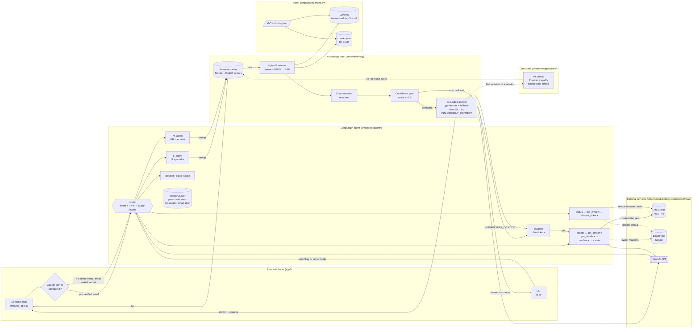
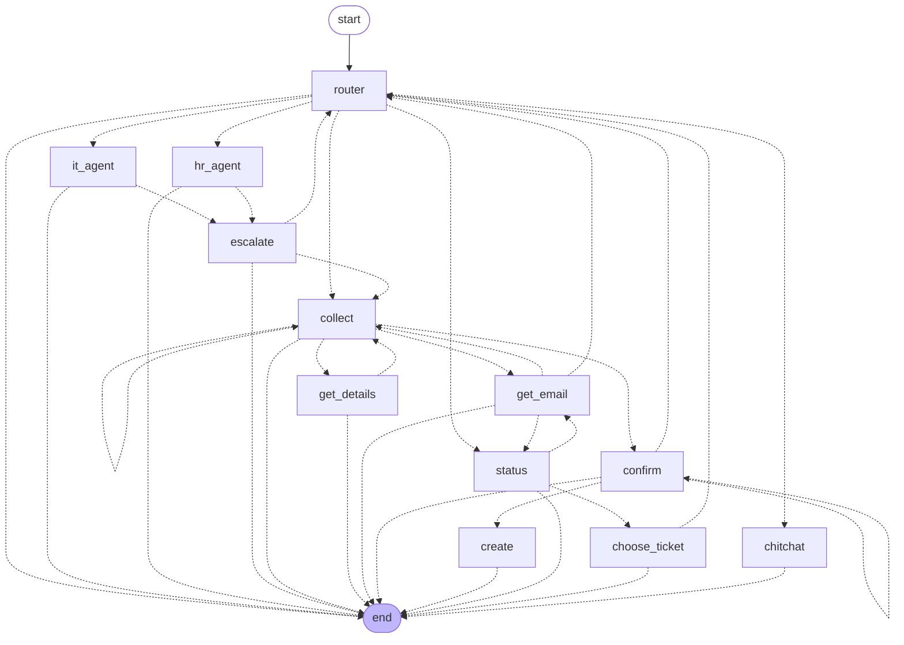
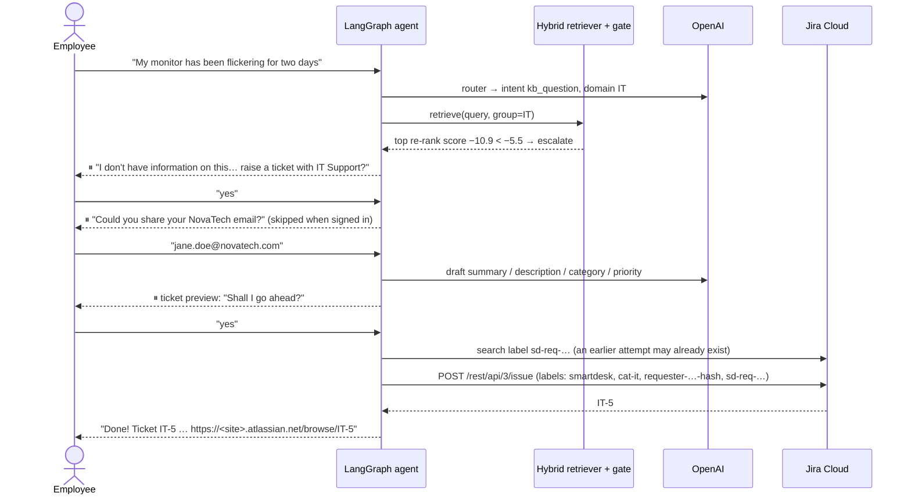
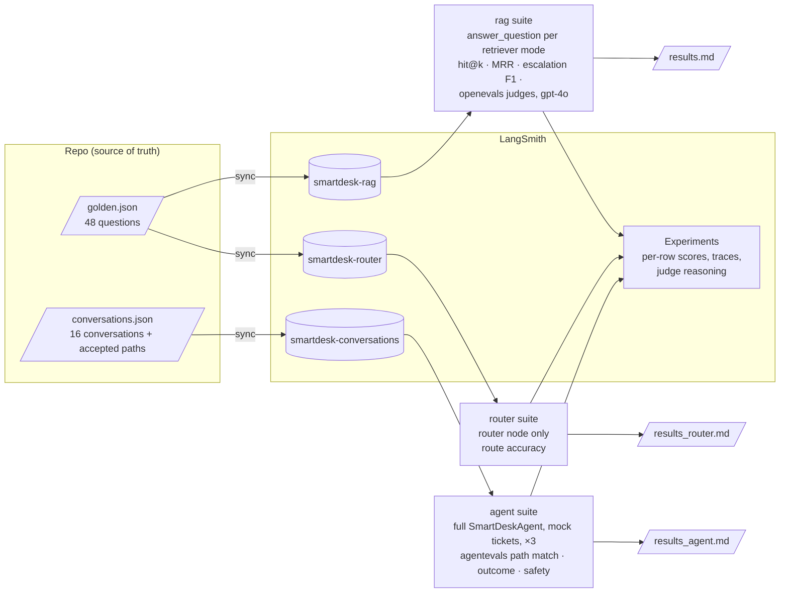

# SmartDesk AI — Architecture

## 1. Components and data flow

⏸ marks a human-in-the-loop pause (`interrupt()`): the graph stops, the UI shows the question, and the employee's
reply resumes the same node. Identity comes from Google sign-in when it's configured; otherwise the app runs in a
labelled demo mode and asks for the email once per session. The semantic cache is checked before retrieval; only
answers to a session's first question are cached, after a PII check that runs off the response path.

## 2. Agent graph (generated from the compiled LangGraph)

`python -c "from smartdesk.agent.flow import SmartDeskAgent; print(SmartDeskAgent().mermaid())"` prints this graph
from the code (edges collapsed here for readability). Every edge is a `Command(goto=...)` decided at runtime; the
`Literal[...]` return type on each node lists where it can go. Notable paths:

- `create` is only reachable from `confirm`, after an explicit "yes".
- `collect → collect`: a new ticket request discards an old failed draft and drafts from scratch.
- `get_details → __end__` and `confirm → __end__`: "no, cancel" ends without creating anything.
- `get_email` is only used in demo mode; with sign-in the email is already in the state.

## 3. Sequence: escalation to a Jira ticket (demo mode)

## 4. Evaluation (eval/, LangSmith)

## 5. Key design decisions

| Decision | Why |
|---|---|
| Header-based chunking + title prefix | Policy sections are self-contained rules, so splitting by section keeps a rule together with its exceptions. The prefix adds the topic for BM25 and embeddings. |
| Hybrid + RRF + cross-encoder | BM25 catches exact terms (GlobalProtect, W-2, YubiKey). Dense search catches paraphrases. The cross-encoder score doubles as the confidence signal: gap topics score about −3 to −11, and the threshold (−5.5) is calibrated by the eval's sweep. |
| Three-layer escalation | No chunks, then the score threshold, then the LLM's `INSUFFICIENT_CONTEXT` self-check (which catches gaps that score above the threshold, e.g. sabbatical at −3.08). A cross-domain retry runs first, so a wrong IT/HR route doesn't cause a false escalation. |
| Router sends every work question to a specialist | Only clearly off-topic messages go to the scope reply. Workplace questions the KB doesn't cover still reach a specialist, which escalates them to a ticket. Found by the router eval (92% → 100%). |
| `interrupt()` for every pending question | Confirmation really blocks ticket creation: `create` is only reachable from `confirm` after an explicit yes. Unambiguous yes/no replies are decided without the LLM. |
| Identity from sign-in, demo mode otherwise | With Google sign-in, the email comes from the login and is re-asserted every turn; typed emails are ignored, so nobody can read a colleague's tickets. Without it, a labelled demo mode trusts the typed email; `REQUIRE_VERIFIED_EMAIL=true` forbids that. |
| Labels + EmailIndex for ownership | Jira has no "requester email" field for non-users. A hashed `requester-…` label makes "my tickets" a JQL query; the local index covers search-index lag. An `sd-req-…` label per draft stops retries creating duplicates. |
| PII-screened, first-turn-only semantic cache | The cache is shared across employees, so answers are cached only when they don't depend on earlier turns and contain no personal data. The check runs after the reply, adding no latency. |
| IT / HR sub-agents | Each has its own persona, a domain-filtered retriever and a cache scope. The router picks one. |
| Three LangSmith eval suites | RAG quality, routing and whole conversations are measured separately, so a router bug can't hide behind good retrieval numbers. Conversations repeat to expose intermittent failures. |
