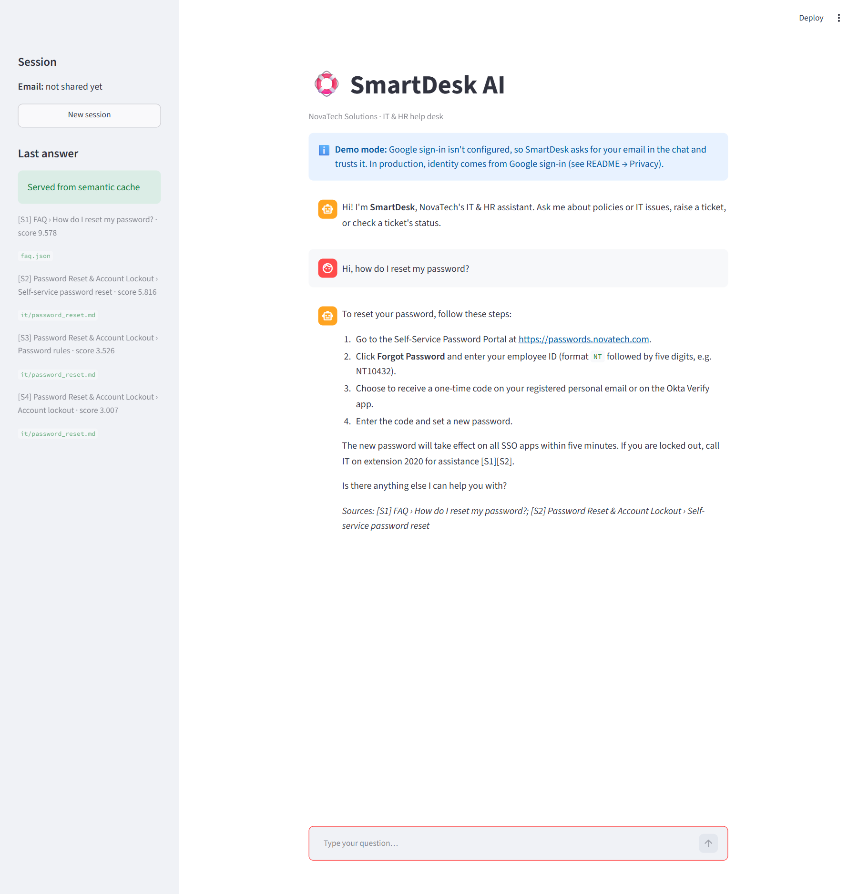
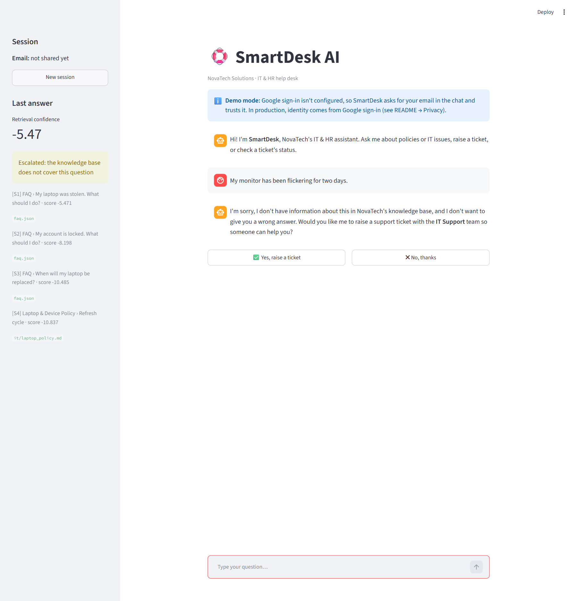
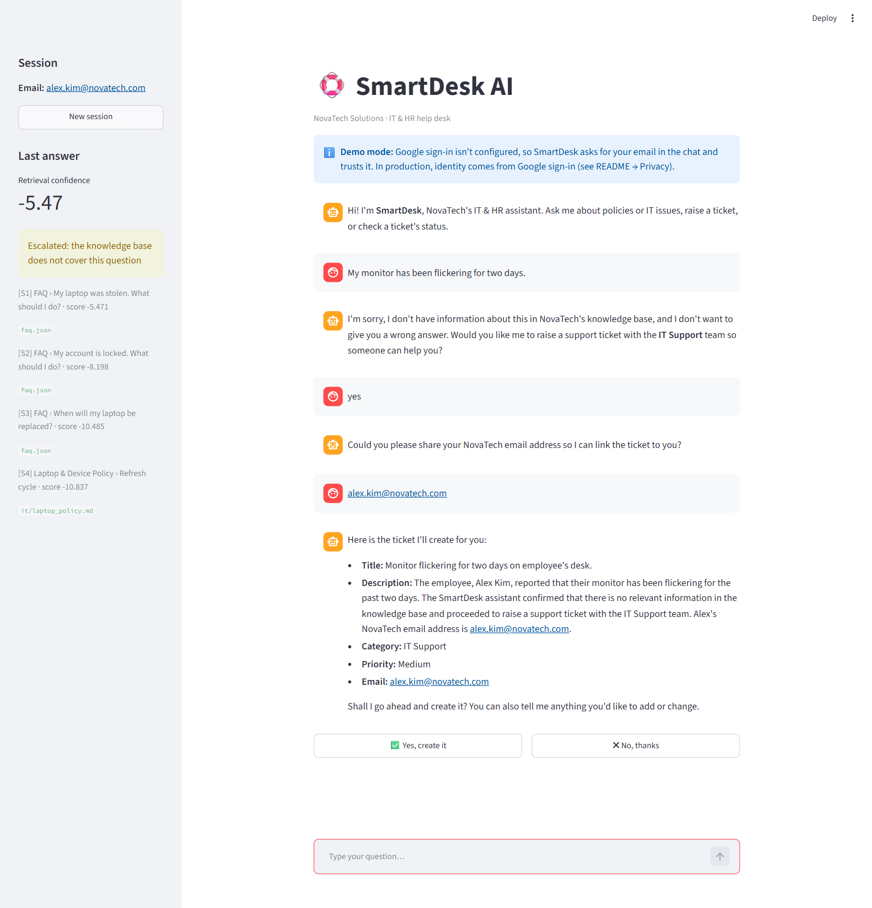
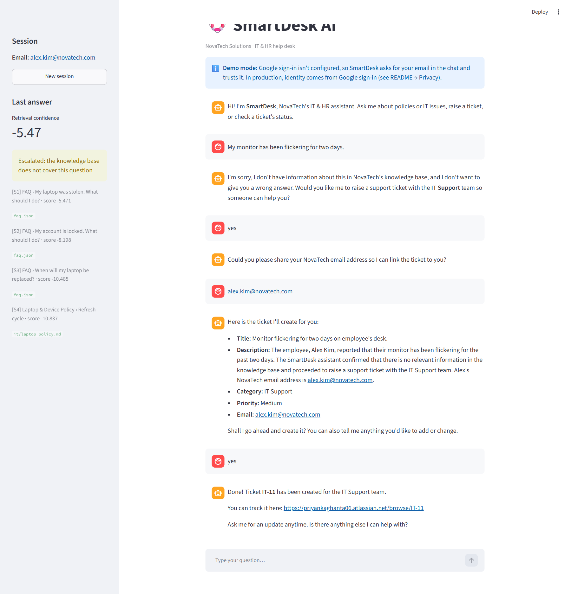
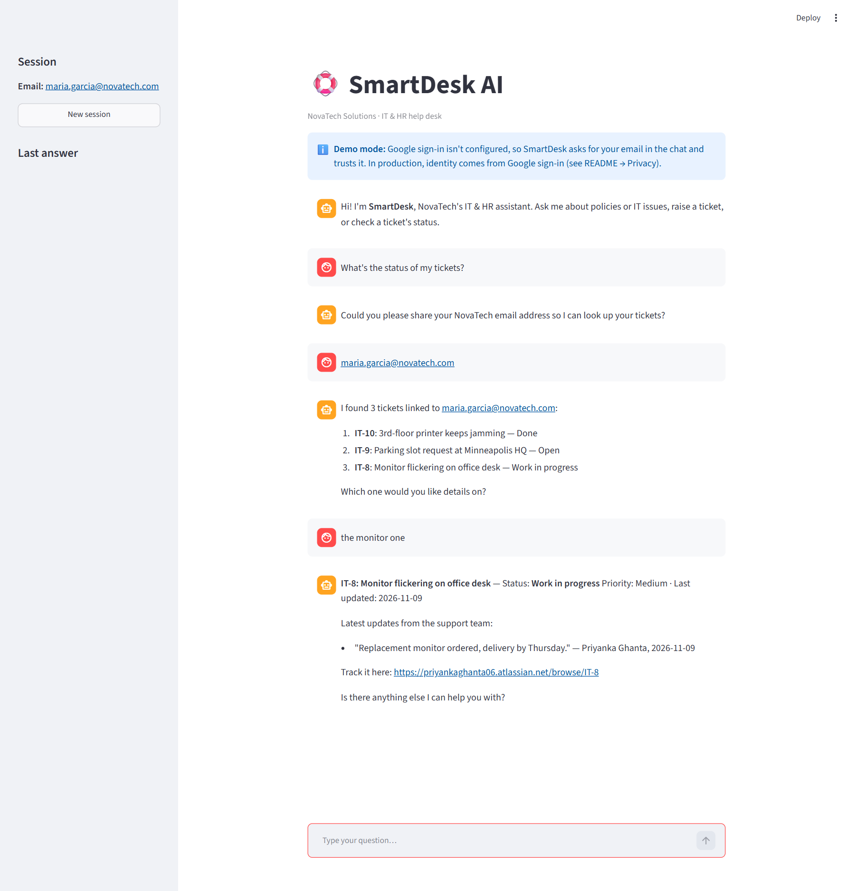
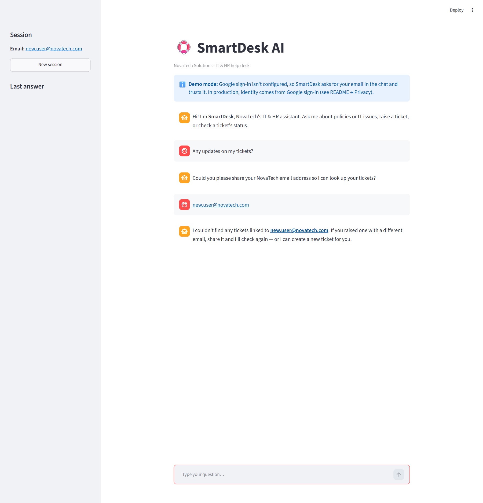

# docs/screenshots/

## Why this folder exists
Graders and reviewers often look at screenshots before running anything. These show each rubric flow working in
the real UI. Kept separate from code so image files don't clutter source folders.

## Files

Captured from the Streamlit UI in demo mode against the live Jira project.

| File | Shows | Why it's included |
|---|---|---|
| `01-kb-answer.png` | A KB answer with `[S1]` citations and the sources footer | RAG grounding |
| `02-escalation-offer.png` | A knowledge-base gap and the ticket offer | Escalation logic |
| `03a-ticket-preview.png` | Email asked once, then the full ticket preview with Yes / No buttons | Ticket creation: confirmation step |
| `03-ticket-confirm.png` | After "Yes": ticket IT-11 created, with its Jira link | Ticket creation with confirmation |
| `04-status-multiple.png` | Several tickets listed, one picked, details with support comments | Ticket status, multiple tickets |
| `05-status-none.png` | The "no tickets found" reply | Ticket status, no-ticket case |

